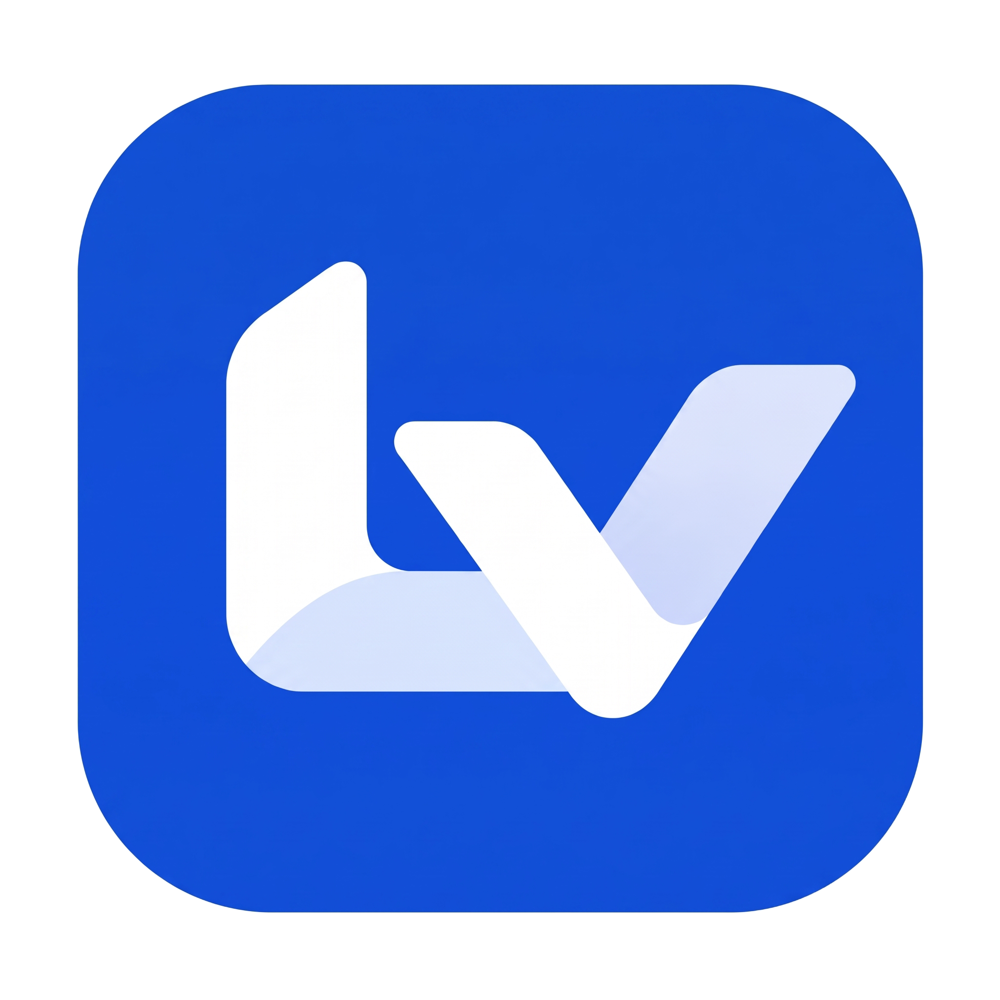
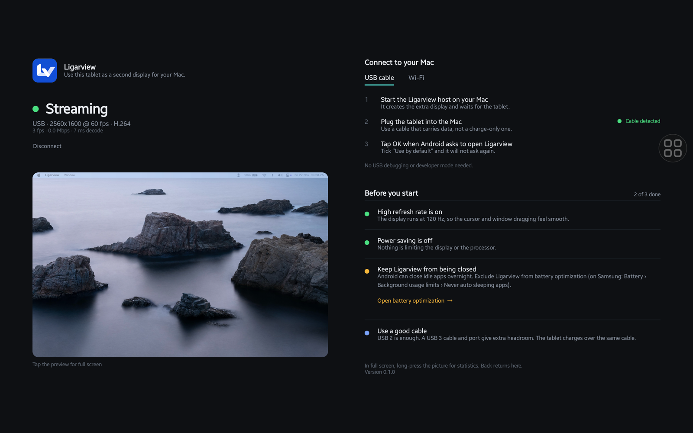

<p align="center"></p>

# Ligarview

Use an Android tablet as a real **extended** second display for your Mac, over Wi-Fi or USB.
Think Sidecar, but for Android (built and tested with a Samsung Galaxy Tab S9).

No touch input, no audio, no extras. The tablet is just a monitor.

Docs: **https://ligarview.rizkykurniawan.id**

## How it works

```
Mac (Rust)                                        Android (Kotlin)
CGVirtualDisplay -> ScreenCaptureKit              USB accessory pipe or TCP
  (extra display)    (capture)  -> VideoToolbox  ====>  MediaCodec -> SurfaceView
                                   H.264 (HW)
USB: Android Open Accessory (no USB debugging)  |  Wi-Fi: TCP  |  developer: `adb reverse`
```

## Layout

- `host/` - macOS host app (Rust)
- `android/` - Android client (Kotlin)

## Status

Early work in progress.

- [x] Host: virtual display
- [x] Host: capture + hardware H.264 encode
- [x] Transport (TCP, works over Wi-Fi and USB via `adb reverse`)
- [x] Android client (MediaCodec low-latency decode, fullscreen)
- [ ] Latency and quality tuning

## Requirements

- macOS 14+ (developed on macOS 15), Apple Silicon
- Rust (stable)
- Android 11+ (API 30), Android SDK + JDK 17+ to build the app
- Screen Recording permission for the host app

## Usage

1. Mac: start the host (creates the extra display and listens on port 7878).

   ```bash
   cd host
   cargo run --release
   ```

   Defaults to a 1280x800 HiDPI display (2560x1600 real pixels, like a Retina Mac) at 60 fps, 30 Mbps.
   For a 120 Hz panel: `cargo run --release -- --fps 120 --bitrate 60`.

   Or run it as an app: `tools/bundle.sh` builds `host/target/Ligarview.app` (move it to Applications
   if you like). It has a Dock icon and a small window that shows the state and lets you pick
   orientation, frame rate, quality and codec, start it at login, and grant the Screen Recording
   permission. Closing the window keeps the host running; click the Dock icon to bring it back.
   Changing a setting relaunches the host with it. Settings live in
   `~/Library/Application Support/Ligarview/config`.

   Options: `--width --height --scale --fps --bitrate <Mbps> --port --stats --codec --low-latency-rc --cursor-in-video --no-adb`.
   `--stats` prints capture/encode rates and latencies once per second.

2. Android: build and install the app (`cd android && ./gradlew installDebug`).
3. Connect:
   - **USB (default, plug and play)**: nothing to enable on the tablet, no USB debugging, no adb. Plug the
     cable in; the host notices the tablet, switches it into USB accessory mode and Android asks once
     whether to open Ligarview for the accessory (tick "use by default" to skip the question next time).
     Measured on a Tab S9 over USB 2.0: 0.25 ms round trip, 215 Mbit/s.
   - **Wi-Fi**: open the app and connect to `<mac-ip>:7878` (same network, 5 GHz recommended). Ports 7878 and 7879 must be reachable.
   - **Developer mode**: `ligarview-host --adb` sets up `adb reverse` tunnels (needs USB debugging); connect to `127.0.0.1:7878`. This replaces the USB accessory transport, the two fight over the device.

   Flags: `--no-usb`, `--no-tcp`, `--adb`.

   **Portrait display** (for reading code with the tablet held upright): run the host with `--portrait`
   (or `--width 800 --height 1280`). The shape of the display is decided by the Mac, the tablet only shows
   it; the app follows the tablet's rotation, the full screen keeps the Mac's proportions (a portrait display
   fills an upright tablet exactly), and the information screen switches to one column.

The app reconnects automatically and remembers the last address. Back returns to the connect screen.
Long-press the picture to show a statistics overlay (fps, bitrate, decoder latency).

Debugging without a tablet: `python3 tools/dump_stream.py 127.0.0.1 7878 5 out.h264` records the video, `python3 tools/dump_cursor.py` prints cursor messages.

## The Android app



The app opens on an information screen and returns to it with Back. On the left: what the tablet is
doing (waiting, cable detected, connecting, streaming with live fps, bitrate and decode time) and a small
live preview of the Mac screen, with the Mac's cursor drawn in it. Tap the preview for full screen; Back
returns to the screen above. On the right: how to connect (USB steps with a live "cable detected"
indicator, or a Wi-Fi address) and recommendations read from the tablet itself: whether the high refresh
rate is on, whether power saving is off (it lowers the refresh rate and slows the decoder), and whether
Android may close the app in the background. Each one links to the right settings page.

It is built with Jetpack Compose. The picture is a `SurfaceView` fed by the hardware decoder; it is moved
and resized between the preview box and the full screen, never recreated, so the stream keeps running.

## Recovery

You should not have to restart anything:

- Unplug and replug the USB cable: the host switches the tablet into accessory mode again and the app reconnects (with `--adb`, the tunnels are re-created instead).
- Restart the host while the tablet waits: the host asks the app whether it wants a stream and the app restarts its session.
- Silent connection loss (Wi-Fi drop, frozen host): the host sends a heartbeat every second; the app
  treats 4 s of silence as a dead link and reconnects.
- Tablet sleep/lock: the app reconnects when it comes back to the foreground.
- Virtual display or capture lost on the Mac (for example after sleep): the host recreates the
  display, the HiDPI mode, capture and encoder, then asks for a keyframe. `--debug-drop-display-after N`
  simulates this.

## Cursor

The cursor is not part of the video. The host sends its position (and shape, when it changes)
on a second connection (video port + 1) and the tablet draws it on top, once per vsync, so the
cursor does not wait for capture + encode + decode. Use `--cursor-in-video` to fall back to a
cursor rendered into the video.

For a smooth 120 Hz panel on Samsung tablets set Settings > Display > Motion smoothness to
Adaptive and turn off Power saving.

## Protocol

Transports: TCP (video on `port`, cursor on `port + 1`) or one USB accessory pipe that carries both as
channels ([`host/src/usb.rs`](host/src/usb.rs)). The streams inside are identical.

Video: [`host/src/protocol.rs`](host/src/protocol.rs) (a 12-byte hello, then length-prefixed Annex-B H.264 frames).
Cursor: [`host/src/cursor_server.rs`](host/src/cursor_server.rs).

## Notes

Codec: H.264 by default. `--codec hevc` also works (the app picks the decoder from the hello
message) but measured the same latency on an M1 Pro / Tab S9 (~41 ms encode, ~8 ms decode);
its benefit is compression efficiency, not speed.

Encoder: the default VideoToolbox mode sustains ~57 fps on a busy 2560x1600 screen with
~40 ms encode latency. `--low-latency-rc` saves ~10 ms per frame but caps throughput near
30 fps, which makes dragging windows look choppy. Captured frames are never queued: the
encoder always takes the newest one and stale frames are dropped.

Latency: VideoToolbox defaults to 11 reference frames, which makes hardware decoders
buffer 20+ frames before output. The host limits it to 1 (`ReferenceBufferCount`),
which took decoder latency on a Tab S9 from ~500 ms to ~40 ms. On Qualcomm devices the
client also sets `vendor.qti-ext-dec-picture-order.enable`, which removes the last held-back
frame (~40 ms -> ~8 ms at 30 fps).

The virtual display uses the private `CGVirtualDisplay` API. It works without
SIP changes or kernel extensions, but Apple may change it in a macOS update.

## License

Licensed under the [Apache License, Version 2.0](LICENSE).
